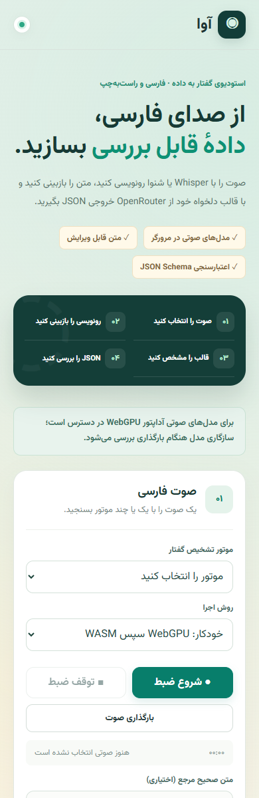

# آوا — گفتار فارسی و استخراج JSON

برنامهٔ فارسی و RTL برای مسیر «صوت → متن قابل ویرایش → JSON مطابق Schema». Whisper Tiny و Small چندزبانه و سه اندازهٔ Shenava در مرورگر اجرا می‌شوند. استخراج JSON با مدل رایگان انتخابی کاربر در API OpenRouter انجام می‌شود. **با درخواست استخراج، متن انتخابی و JSON Schema به OpenRouter ارسال می‌شوند؛ فایل صوتی ارسال نمی‌شود.** کلید API از `.env` فقط در فرایند Node خوانده می‌شود؛ مرورگر آن را دریافت نمی‌کند.

## نمای برنامه


نمای نزدیک‌تر از ابتدای صفحه و چیدمان باریک:



این تصویرها از **نسخهٔ ساخته‌شده و در حال اجرای برنامه** در Chrome Headless با فونت محلی Vazirmatn گرفته شده‌اند. وضعیت اولیهٔ صفحه را پس از آماده‌شدن وضعیت کش نشان می‌دهند؛ هیچ رونویسی یا پاسخ OpenRouter در تصویرها شبیه‌سازی نشده است. تصویر موبایل عرض واقعی ۳۹۰ پیکسل دارد.

## پیش‌نیازها

- Node.js و npm؛ این نسخه با Node.js 24 آزموده شده است.
- مرورگر جدید با WebAssembly؛ WebGPU برای دستگاه‌های سازگار اختیاری است. ضبط صدا به مجوز میکروفن نیاز دارد.
- فضای ذخیره و حافظهٔ کافی برای مدل انتخابی؛ اندازهٔ تقریبی هر مدل پیش از دریافت در برنامه نمایش داده می‌شود.
- اتصال اینترنت برای دانلود اولیهٔ مدل‌های صوتی و هر درخواست استخراج JSON. برای OpenRouter، کلید API لازم است.

## اجرا

```bash
npm ci
npm run dev
```

پیش از اجرا، `.env.example` را الگو بگیرید و کلید خود را در فایل `.env` با نام `OPENROUTER_API_KEY` قرار دهید. نام قبلی `OPENROUTER_APIKEY` نیز پشتیبانی می‌شود. فایل `.env` در Git نادیده گرفته می‌شود. مقدار کلید را با پیشوند `VITE_` تعریف نکنید؛ متغیرهای دارای این پیشوند در بستهٔ مرورگر قابل دسترسی‌اند.

نمونهٔ محتوای `.env`؛ مقدار نمونه را با کلید واقعی خود جایگزین کنید:

```dotenv
OPENROUTER_API_KEY=sk-or-v1-your-key-here
```

اگر از قبل `.env` دارید، آن را با `.env.example` بازنویسی نکنید. پس از تغییر کلید، فرایند Node را دوباره اجرا کنید؛ صفحه فقط بارگذاری‌شدن کلید در سرور را نشان می‌دهد، نه معتبر بودن آن یا دسترسی به OpenRouter. برای استفاده از ASR به کلید OpenRouter نیاز نیست.

برنامه در `http://127.0.0.1:5173/` باز می‌شود. برای اجرای بستهٔ ساخته‌شده، `npm run build` و سپس `npm start` را اجرا کنید. `npm run typecheck` و `npm test` نیز در دسترس‌اند. سرور به‌طور پیش‌فرض فقط روی `127.0.0.1` گوش می‌دهد؛ برای پورت دیگر `PORT` را تنظیم کنید. ضبط میکروفن به localhost یا HTTPS نیاز دارد. رایگان بودن و دسترسی هر مدل ممکن است تغییر کند.

درخواست‌های مرورگر به `/api/extract` در همان مبدأ می‌روند و فقط متن، Schema و شناسهٔ مدل را حمل می‌کنند. سرور، کلید را به درخواست ثابت OpenRouter اضافه می‌کند؛ مدل‌ها به فهرست مجاز محدودند و خروجی روی سرور و دوباره در مرورگر با Ajv بررسی می‌شود. `/api/status` فقط آماده‌بودن کلید را اعلام می‌کند. این سرور محلی برای استفادهٔ شخصی طراحی شده است؛ برای انتشار عمومی، احراز هویت و محدودسازی نرخ درخواست لازم است.

### مسیر استفاده

1. در بخش «صوت فارسی» یک موتور یا حالت مقایسه را انتخاب کنید. می‌توانید فایل صوتی بارگذاری کنید یا با مجوز مرورگر ضبط کنید. سقف ورودی ۲ دقیقه و ۲۵ مگابایت است.
2. روی «تبدیل صوت به متن» بزنید. هر موتور نتیجه و خطای خود را جدا نشان می‌دهد. در حالت مقایسه، همان صوت برای همه استفاده می‌شود و مدل‌ها پشت سر هم اجرا می‌شوند.
3. اگر متن صحیح را دارید، آن را در «متن صحیح مرجع» وارد کنید تا WER و CER محاسبه شوند. متن خام مدل حفظ می‌شود؛ نسخهٔ ویرایش‌شده را زیر نتیجهٔ هر موتور اصلاح کنید و «استفاده از این متن» را بزنید. برای سنجش مستقیم استخراج، دکمهٔ «استفاده از متن مرجع برای JSON» نیز وجود دارد.
4. در بخش «قالب اجباری JSON» یک JSON Schema Draft-07 وارد کنید. در «راهنمای معنایی فیلدها»، حوزهٔ کل داده و معنای هر فیلد را بنویسید؛ مثلاً برای `items[].name` بنویسید «نام یک میوه». این متن‌ها به `description` همان Schema افزوده می‌شوند و همراه قالب ذخیره یا صادر می‌شوند. سپس «بررسی قالب» را بزنید.
5. مدل OpenRouter را انتخاب کنید و «تبدیل متن به JSON» را بزنید. مصرف توکن ورودی، خروجی و مجموع، و در صورت گزارش سرویس توکن استدلال و ورودی کش‌شده، کنار نتیجه نمایش داده می‌شود. توکن استدلال بخشی از خروجی است و دوباره به مجموع اضافه نمی‌شود. JSON را بازبینی، کپی یا دانلود کنید. در مقایسهٔ JSON، مصرف هر درخواست جدا نشان داده می‌شود.
6. «دریافت گزارش مقایسه» متن‌های خام و ویرایش‌شده، نسخه‌ها، زمان‌ها، روش اجرا، خطاها و معیارهای موجود را به صورت JSON ذخیره می‌کند. صوت و کلید API در گزارش نیستند.

برای آزمایش مسیر استخراج بدون دانلود مدل صوتی، در بخش متن روی «بارگذاری نمونه» بزنید، Schema نمونه را بررسی کنید و سپس استخراج JSON را اجرا کنید. این کار همچنان یک درخواست واقعی OpenRouter مصرف می‌کند.

### نمونهٔ قالب

این نمونه فقط شکل یک Schema اجباری را نشان می‌دهد؛ فیلدها را با نیاز خود عوض کنید:

```json
{
  "$schema": "http://json-schema.org/draft-07/schema#",
  "type": "object",
  "additionalProperties": false,
  "properties": {
    "customer": { "type": "string", "description": "نام و نام خانوادگی ایرانی مشتری؛ عنوان احترام را حذف کن" },
    "quantity": { "type": "number", "description": "تعداد کالای فروخته‌شده" }
  },
  "required": ["customer", "quantity"]
}
```

اگر داده‌ای در متن وجود ندارد، Schema باید صریحاً اجازهٔ مقدار جایگزین مانند `null` را بدهد. معتبر بودن JSON نسبت به Schema به معنی درست بودن برداشت مدل از متن نیست.

## موتورهای گفتار

| موتور | مخزن و revision | فایل‌های اصلی | حجم تقریبی |
|---|---|---|---|
| Whisper Tiny چندزبانه | [`onnx-community/whisper-tiny`](https://huggingface.co/onnx-community/whisper-tiny/tree/ff41770)، `ff41770` | encoder FP32 و decoder merged q4 | ۱۲۴ MB |
| Whisper Small چندزبانه | [`onnx-community/whisper-small`](https://huggingface.co/onnx-community/whisper-small/tree/461d552a09349d5d0d0779b40dd79800eaa3e35a)، `461d552a09349d5d0d0779b40dd79800eaa3e35a` | encoder FP16 و decoder merged q4 | ۴۱۴ MB |
| Shenava Rizeh-Pizeh v1.0 | [`Reza2kn/Shenava-Rizeh-Pizeh-v1.0-ONNX-fp16`](https://huggingface.co/Reza2kn/Shenava-Rizeh-Pizeh-v1.0-ONNX-fp16/tree/788f262)، `788f262` | ONNX FP16 و فایل‌های پیش‌پردازش/واژگان | ۱۷٫۳ MB |
| Shenava Rizeh v1.0 | [`Reza2kn/Shenava-Rizeh-v1.0-ONNX-fp16`](https://huggingface.co/Reza2kn/Shenava-Rizeh-v1.0-ONNX-fp16/blob/main/export_manifest.json)، `d393dce` | ONNX FP16 تک‌فایلی، ۵۸٬۹۸۲٬۶۷۳ بایت + فایل‌های جانبی | ۵۹٫۱ MB |
| Shenava Koochik v1.0 | [`Reza2kn/Shenava-Koochik-v1.0-ONNX-fp16`](https://huggingface.co/Reza2kn/Shenava-Koochik-v1.0-ONNX-fp16/blob/main/export_manifest.json)، `9c0d635` | ONNX FP16 تک‌فایلی، ۲۳۰٬۰۷۵٬۶۰۹ بایت + فایل‌های جانبی | ۲۳۰٫۲ MB |

مدل‌ها فقط هنگام نیاز بارگذاری می‌شوند. مقایسه از یک صوت مشترک استفاده می‌کند، موتورهای انتخابی را ترتیبی اجرا می‌کند و Worker و منابع موتور قبلی را پیش از بارگذاری موتور بعدی آزاد می‌کند. خطا و پیشرفت هر موتور جدا نمایش داده می‌شود. هر سه شنوا مستقیماً با `onnxruntime-web` در Web Worker اجرا می‌شوند و از pipeline ویسپر استفاده نمی‌کنند. قرارداد [preprocessor.json](https://huggingface.co/Reza2kn/Shenava-Rizeh-Pizeh-v1.0-ONNX-fp16/blob/main/preprocessor.json)، [fbank.rs](https://github.com/Reza2kn/shenava-asr-server/blob/main/src/fbank.rs) و [decode.rs](https://github.com/Reza2kn/shenava-asr-server/blob/main/src/decode.rs) مبنای پیش‌پردازش و CTC هستند؛ هنگام بارگذاری، فیلدهای مهم قرارداد هر نسخه با فایل خودش تطبیق داده می‌شوند. تطابق عددی کامل با NeMo روی مجموعهٔ مرجع هنوز آزموده نشده است.

گزینه‌های مقایسه در رابط شامل «Whisper Tiny و شنوا ریزه‌پیزه»، «سه شنوا» و «همهٔ پنج موتور» هستند. مدل پیش‌فرض ASR انتخاب نشده است: برای ترجیح دادن یک مدل بر اساس دقت فارسی، باید همه با مجموعهٔ صوتی مرجع‌دار یکسان سنجیده شوند. در انتخاب دستی، برای دستگاه کم‌حافظه از مدل کوچک‌تر شروع کنید؛ نتیجهٔ بهتر از روی اندازهٔ فایل به‌تنهایی قابل استنتاج نیست.

زمان «بارگذاری» شامل دریافت و آماده‌سازی مدل است. «پیش‌پردازش» و «استنتاج» جدا ثبت می‌شوند. «کل بدون دانلود» زمان تبدیل صوت به متن پس از آماده بودن مدل را گزارش می‌کند. RTF نسبت زمان پردازش به مدت صوت است؛ عدد کوچک‌تر از ۱ یعنی پردازش سریع‌تر از زمان واقعی صوت. روش اجرای واقعی WebGPU یا WASM برای هر نتیجه نوشته می‌شود.

پیشرفت هر فایل مدل جدا نشان داده می‌شود، چون دریافت encoder، decoder و فایل‌های تنظیمات ممکن است هم‌زمان انجام شود. تغییر عدد بین دو فایل به معنی شروع دوبارهٔ دانلود نیست. در حالت اجرای «خودکار»، اگر آماده‌سازی WebGPU شکست بخورد، برنامه علت را در وضعیت اعلام می‌کند و WASM را می‌آزماید؛ روش نهایی در کارت نتیجه ثبت می‌شود. گزینهٔ «فقط WebGPU» جایگزینی خودکار ندارد.

### نگهداری وزن مدل‌ها

Whisper با Cache API خود Transformers.js و شنوا با کش `ava-models-v2` فایل‌های دریافت‌شده را در فضای داخلی همان مبدأ مرورگر نگه می‌دارند. بارگذاری بعدی، حتی پس از بستن برگه، از فایل‌های کش‌شده استفاده می‌کند؛ برای شنوا اندازهٔ کامل ONNX با manifest بررسی می‌شود. دکمهٔ «درخواست نگهداری پایدار» از `navigator.storage.persist()` استفاده می‌کند؛ در صورت تأیید مرورگر، حذف خودکار به‌علت فشار فضا کاهش می‌یابد. این فایل‌ها داخل پوشهٔ پروژه کپی نمی‌شوند و میان مرورگرها یا نشانی‌های متفاوت (مثلاً پورت‌های ۵۱۷۳ و ۵۱۷۴) مشترک نیستند. پاک کردن داده‌های سایت یا کش مدل‌ها آن‌ها را حذف می‌کند. Service Worker قدیمی که فایل‌های اجرایی برنامه را کش می‌کرد در نسخهٔ جدید غیرفعال و کش پوستهٔ آن حذف می‌شود؛ کش وزن‌های مدل دست‌نخورده باقی می‌ماند. عدد «فضای استفاده‌شده» برآورد کل داده‌های همین مبدأ در مرورگر است، نه فقط وزن مدل‌ها.

## استخراج JSON با OpenRouter

چهار مدل با پشتیبانی اعلام‌شده از JSON Schema در صفحه‌های رسمی OpenRouter قابل انتخاب‌اند: [Nemotron 3.5 Super VL](https://openrouter.ai/nvidia/nemotron-3.5-super-vl:free)، [ERNIE 5.5 Flash Preview](https://openrouter.ai/baidu/ernie-5.5-flash-preview:free)، [Ling 3.2 Flash](https://openrouter.ai/inclusionai/ling-3.2-flash:free) و [LFM3 1.7B](https://openrouter.ai/liquid/lfm-3-1.7b:free). هر چهار شناسه `:free` دارند. [مستندات سقف رایگان OpenRouter](https://openrouter.ai/collections/free-models) فعلاً ۲۰ درخواست در دقیقه و ۵۰ درخواست در روز برای حساب بدون خرید اعتبار، یا تا ۱۰۰۰ درخواست در روز پس از خرید اعتبار کافی، اعلام می‌کند. این سقف میان مدل‌های رایگان مشترک است؛ انتخاب مدل دیگر سهمیهٔ هفتگی مستقلی ایجاد نمی‌کند. مدل‌هایی مانند Nemotron 3.5 Lightning رایگان، با اینکه فراخوانی تابع دارند، `response_format` ندارند و برای Schema اجباری این برنامه انتخاب نشده‌اند.

مدل انتخابی با `POST https://openrouter.ai/api/v1/chat/completions` فراخوانی می‌شود. درخواست، Schema بسته‌شده، شامل `description`های حوزه و فیلدها، را در `response_format` با `json_schema` و `strict: true` می‌فرستد و `provider.require_parameters: true` دارد. توضیح‌ها به مدل برای رفع خطاهای واضح رونویسی در مقدارهای JSON زمینه می‌دهند؛ متن رونویسی اصلی تغییر نمی‌کند و تصحیح معنایی قطعی نیست. خروجی با Ajv اعتبارسنجی می‌شود. برخی Schemaهای Draft-07، به‌ویژه فیلدهای اختیاری یا `$ref`های پیچیده، ممکن است توسط حالت strict سرویس رد شوند. مصرف توکن از `usage` پاسخ OpenRouter می‌آید؛ اگر سرویس آن را ندهد، عددی تخمین زده نمی‌شود.

متن خام هر ASR حفظ می‌شود؛ کاربر می‌تواند نسخهٔ ویرایش‌شده یا متن مرجع را برای استخراج انتخاب کند. مقایسهٔ JSON برای چند خروجی ASR با همان Schema و مدل به‌صورت ترتیبی انجام می‌شود و زمان و خطای هر درخواست جدا نمایش داده می‌شود. هر درخواست مقایسه یک فراخوانی API و بخشی از سهمیهٔ مدل رایگان است. دکمهٔ توقف، درخواست جاری را با `AbortController` لغو می‌کند؛ لغو سمت مرورگر لزوماً به معنی لغو محاسبه یا سهمیه در سرویس نیست.

## معیارها و گزارش

WER و CER فقط هنگام ورود متن مرجع محاسبه می‌شوند. برای خروجی‌ها و مرجع، `NFKC`، یکسان‌سازی حروف `ی/ک/ه/ا` و ارقام، حذف اعراب/علائم، تبدیل نیم‌فاصله به فاصله و فشرده‌سازی فاصله‌ها اعمال می‌شود. CER فاصله‌ها را نمی‌شمارد. متن خام، متن ویرایش‌شده، نسخهٔ مدل‌ها، روش اجرا، زمان‌ها، خطاها و معیارها در گزارش JSON می‌آیند؛ خود صوت و کلید API در گزارش نیستند. مدل پیش‌فرض ASR بر اساس دقت فارسی انتخاب نشده است، چون آزمون با صوت فارسی دارای متن مرجع یکسان برای همهٔ موتورها انجام نشده است.

WER تعداد ویرایش واژه‌ها تقسیم بر تعداد واژه‌های متن مرجع است؛ CER همین نسبت را برای نویسه‌ها پس از حذف فاصله‌ها محاسبه می‌کند. این‌ها **نرخ خطا** هستند و ممکن است در برخی خروجی‌ها از ۱۰۰٪ هم بیشتر شوند. بدون متن مرجع، برنامه درصد دقت حدسی تولید نمی‌کند. معیارها روی متن خام ASR محاسبه می‌شوند تا ویرایش کاربر نتیجهٔ ارزیابی مدل را عوض نکند.

## داده، امنیت و اجزای برنامه

| داده یا عملیات | محل پردازش و نگهداری |
|---|---|
| فایل صوتی و استنتاج Whisper و Shenava | مرورگر؛ در درخواست استخراج به OpenRouter یا API محلی ارسال نمی‌شود. |
| وزن‌های مدل صوتی | Cache API همان مبدأ مرورگر؛ حذف داده‌های سایت یا فشار فضا ممکن است آن‌ها را پاک کند. |
| متن و JSON Schema هنگام استخراج | از مرورگر به سرور محلی، سپس به OpenRouter ارسال می‌شود. |
| کلید OpenRouter | فقط متغیر محیطی فرایند Node؛ به بستهٔ مرورگر، گزارش و پاسخ API افزوده نمی‌شود. |
| قالب‌های ذخیره‌شده | IndexedDB مرورگر، برای همان مبدأ. |

`server/index.mjs` فایل `.env` را می‌خواند و نسخهٔ توسعه یا فایل‌های `dist` را سرو می‌کند. `server/api.mjs` فقط مسیرهای `/api/status` و `/api/extract` را پاسخ می‌دهد، مبدأ و مدل را بررسی می‌کند و کلید را به درخواست ثابت OpenRouter اضافه می‌کند. `src/openrouter.ts` کلاینت بدون کلید است. `src/asr.worker.ts` بارگذاری و اجرای موتورهای صوتی را در Worker انجام می‌دهد؛ `src/shenava.ts` پیش‌پردازش و رمزگشایی شنوا را پیاده می‌کند. `src/schema.ts` قالب و خروجی را با Ajv بررسی می‌کند و `src/metrics.ts` یکسان‌سازی فارسی و WER/CER را محاسبه می‌کند.

سرور فعلی روی `127.0.0.1` گوش می‌دهد و برای استفادهٔ محلی است. اگر آن را پشت پراکسی یا روی اینترنت منتشر می‌کنید، پیش از آن احراز هویت، HTTPS و محدودیت نرخ درخواست اضافه کنید. در این برنامه، «پردازش صوت محلی» شامل مرحلهٔ استخراج JSON نیست؛ متن منتخب در آن مرحله به سرویس خارجی می‌رود.

## رفع مشکل

| نشانه | اقدام |
|---|---|
| صفحه با `file://` باز شده یا سرویس محلی در دسترس نیست | برنامه را با `npm run dev` یا پس از build با `npm start` باز کنید؛ نشانی پیش‌فرض `http://127.0.0.1:5173/` است. |
| پیام «کلید OpenRouter در سرور تنظیم نشده است» | `.env` را در ریشهٔ پروژه با `OPENROUTER_API_KEY` بررسی کنید و سرور را دوباره اجرا کنید. کلید را در فایل‌های `src` یا متغیر `VITE_` نگذارید. |
| `OpenRouter HTTP 403` | اگر پیام `Access denied by security policy.` باشد و پروکسی محلی دارید، پیش از `npm run dev` در همان PowerShell دستور `$env:NODE_USE_ENV_PROXY='1'` را بزنید و سرور را دوباره اجرا کنید. در این محیط، درخواست بررسی کلید با پروکسی پاسخ 200 داد. برای خطاهای دیگر، پیام OpenRouter و محدودیت حساب یا مدل را بررسی کنید. |
| خطای WebGPU یا کمبود حافظه | روش WASM و مدل صوتی کوچک‌تر را امتحان کنید؛ برای Whisper Small و Shenava Koochik حافظه و فضای بیشتری لازم است. خطای هر موتور در کارت همان موتور می‌آید. |
| مدل دوباره دانلود می‌شود | مبدأ، مرورگر و پروفایل را یکسان نگه دارید؛ کش پورت‌های مختلف مشترک نیست. وضعیت فضای کش و نگهداری پایدار را در انتهای صفحه ببینید. |
| پس از به‌روزرسانی هنوز خطای بارگذاری فایل `.mjs` دیده می‌شود | سرور را دوباره اجرا و صفحه را دوبار تازه‌سازی کنید تا Service Worker قدیمی جایگزین شود. کش وزن مدل‌ها را در قدم اول حذف نکنید؛ نسخهٔ جدید فقط کش قدیمی پوستهٔ برنامه را پاک می‌کند. |
| میکروفن کار نمی‌کند | مجوز میکروفن را در مرورگر بررسی کنید و از localhost یا HTTPS استفاده کنید. بارگذاری فایل صوتی مسیر جایگزین است. |
| استخراج با HTTP 429 یا خطای Schema شکست می‌خورد | وضعیت سهمیهٔ حساب و پشتیبانی مدل از `json_schema` را بررسی کنید. قالب را در صفحه اعتبارسنجی کنید؛ پذیرش محلی Schema تضمین پذیرش حالت strict ارائه‌دهنده نیست. |

## توسعه و آزمون

```bash
npm run typecheck
npm test
npm run build
npm start
```

تست‌های `src/*.test.ts` و `server/api.test.mjs` از پاسخ‌های mock استفاده می‌کنند و کلید واقعی یا درخواست زندهٔ OpenRouter مصرف نمی‌کنند. تصویرهای `docs/screenshots` از نسخهٔ production در حالت اولیه گرفته شده‌اند؛ وجود تصویر، آزمون دقت ASR یا موفقیت استخراج واقعی نیست. برای به‌روزرسانی تصویرها، ابتدا build و سرور را اجرا و سپس از همان صفحه در عرض‌های دسکتاپ و باریک عکس بگیرید.

## وضعیت آزمون

| بخش | وضعیت |
|---|---|
| تست‌های واحد | ۲۲ تست: Schema و توضیح فیلدها، WER/CER فارسی، آماده‌سازی/CTC شنوا، پیشرفت هم‌زمان چند فایل، MIME فایل‌های runtime، کلاینت بدون کلید و مسیر API سرور با پاسخ mock بررسی شدند. |
| Shenava Rizeh-Pizeh واقعی | ONNX با صوت سکوت یک‌ثانیه‌ای روی WASM و WebGPU اجرا شد؛ پس از افزودن بررسی فایل `preprocessor.json` نیز روی WASM دوباره اجرا شد. |
| Shenava Rizeh واقعی | ONNX با همان صوت روی WASM اجرا شد؛ بارگذاری اول حدود ۲۱۴ ثانیه و اجرای دوباره از کش حدود ۴ ثانیه طول کشید. خروجی سکوت خالی بود. |
| Shenava Koochik واقعی | ONNX با همان صوت روی WASM اجرا شد؛ بارگذاری اول حدود ۱۷۹ ثانیه و اجرای دوباره پس از بارگذاری مجدد صفحه حدود ۵٫۸ ثانیه طول کشید. فایل ۲۳۰ MB از کش خوانده شد و خروجی سکوت خالی بود. |
| مدل واقعی Whisper Tiny و Small | هر دو روی WebGPU با همان صوت سکوت اجرا شدند. خروجی سکوت حاوی توهم بود و معیار دقت فارسی نیست. |
| آزمون واقعی پس از اصلاح کش | Shenava Rizeh-Pizeh و Whisper Tiny هرکدام با صوت سکوت یک‌ثانیه‌ای روی WASM دو بار در یک پروفایل Chrome Headless اجرا شدند. اجرای دوم پس از reload از کش بود؛ زمان آماده‌سازی به‌ترتیب از ۱۰٫۳ به ۱٫۶ ثانیه و از ۴۹٫۳ به ۱٫۴ ثانیه رسید. این آزمون سلامت بارگذاری و کش است، نه دقت فارسی. |
| خطای WebGPU گزارش‌شده | پاسخ واقعی فایل `.mjs` سرور با `Content-Type: text/javascript` بررسی شد و Service Worker دیگر آن را کش نمی‌کند. اجرای واقعی WebGPU پس از این اصلاح در مرورگر دارای آداپتور GPU آزموده نشده است. |
| OpenRouter واقعی | با فعال‌کردن پروکسی Node، درخواست بررسی کلید `200` داد. یک استخراج کوچک با Schema دارای `description` نیز `200` و JSON معتبر داد؛ `usage` همان پاسخ ۸۴ توکن ورودی، ۴۵۳ خروجی و ۵۳۷ مجموع را گزارش کرد. این آزمون دقت تصحیح رونویسی روی دادهٔ واقعی را نشان نمی‌دهد. |
| کش و نگهداری پایدار | استفادهٔ دوباره از کش برای ریزه و کوچک تأیید شد. مرورگر آزمون درخواست `storage.persist()` را رد کرد؛ کش پاک نشد، ولی ضمانت ماندگاری در فشار فضا فراهم نشد. |
| دقت فارسی/آفلاین | دقت روی صوت فارسی مرجع‌دار، اجرای آفلاین کامل مدل‌های صوتی و خطاهای شبکه/سهمیه آزموده نشده‌اند. استخراج OpenRouter به شبکه نیاز دارد. |
| بازبینی بصری رابط جدید | سه تصویر README از build جدید با فونت محلی Vazirmatn در Chrome Headless با عرض ۱۴۴۰ و ۳۹۰ پیکسل دوباره گرفته و بررسی شدند. تعامل‌های بصری پس از کلیک به‌صورت کامل آزموده نشده‌اند. |

پیش از تغییر به OpenRouter، Qwen 0.5B در مرورگر با نمونهٔ متن اجرا شده بود، اما اکنون مسیر Qwen از برنامه حذف شده است. نتیجهٔ آن آزمون مبنای ادعای عملکرد Nemotron نیست.
